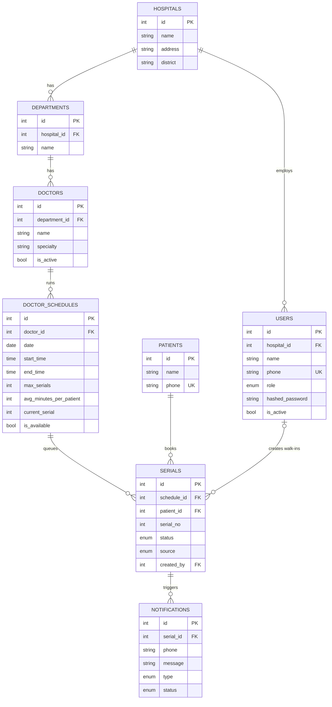
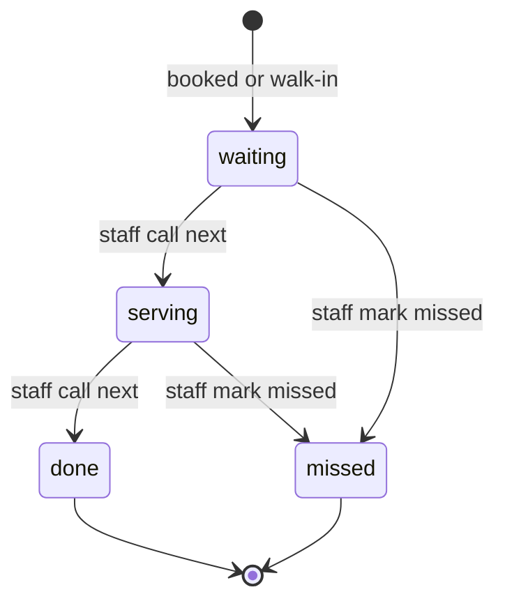

# Doctor Dekhi

A hospital serial and queue backend for public hospitals in Bangladesh.

## Problem and solution

Patients at public hospitals often arrive before dawn to stand in a serial line,
then wait for hours with no idea when the doctor will see them.

Doctor Dekhi lets a patient book a serial and follow the live queue with only a
phone number. Staff run the same queue from the counter, including walk-ins, missed
patients and cancelled sessions.

## Features

**Patients (no account needed)**

- Browse hospitals, departments and available doctors
- Book a serial with any common Bangladeshi phone format
- See people ahead, the estimated wait, and whether a serial is on hold

**Staff (JWT login)**

- See a hospital's schedules and queues
- Call the next patient, with an optional double-click guard
- Mark patients as missed and add walk-ins
- Cancel or reopen a schedule (admins only)

**Mock SMS**

- Booking confirmation, "your turn is near" and session cancelled messages

## Tech stack

| Area | Choice |
| --- | --- |
| Language | Python 3.11+ |
| API | FastAPI, Pydantic v2 |
| Database | PostgreSQL on Neon, SQLAlchemy 2.0, psycopg 3 |
| Auth | JWT (PyJWT), bcrypt password hashes (passlib) |
| API docs | Swagger UI, Scalar |
| Tests | pytest, FastAPI TestClient |

## Architecture

Each request moves down one layer at a time:

```text
routers/   HTTP only: paths, status codes, docs, auth dependencies
   |
services/  Business rules, transactions and row locks
   |
models.py  SQLAlchemy tables, enums and constraints
```

`schemas/` holds the Pydantic request and response shapes used by routers and
services.

```text
app/
  main.py        App setup, GET /, /health and /scalar
  api_docs.py    The text at the top of Swagger and Scalar
  config.py      Settings from .env, and database selection
  database.py    Engine, sessions and the transaction helper
  models.py      Tables and enums
  core/          Errors, auth checks, passwords, tokens, phone and BD time helpers
  routers/       hospitals, doctors, serials, auth, staff
  schemas/       Request and response models
  services/      auth, demo, doctor, hospital, queue and serial logic
tests/           pytest suite
seed.py          Resets a database and inserts demo data
pytest.ini       Test settings
```

## Data model

| Table | Purpose |
| --- | --- |
| `hospitals` | A hospital and its district |
| `departments` | Departments of a hospital |
| `doctors` | Doctors of a department |
| `doctor_schedules` | One session of a doctor, with capacity and the current serial |
| `patients` | A patient, identified by a unique phone number |
| `users` | Staff logins with a role and, except for super admins, a hospital |
| `serials` | A patient's numbered place in a schedule's queue |
| `notifications` | The mock SMS log |



## Serial status lifecycle



Any other change returns `INVALID_STATUS_TRANSITION`. A cancelled schedule has no
status of its own: its waiting serials show as on hold, and continue if it reopens.
A patient who missed their turn can book again.

## Endpoints

| Method | Path | Access | Purpose |
| --- | --- | --- | --- |
| GET | `/hospitals` | Public | List hospitals |
| GET | `/hospitals/{hospital_id}/departments` | Public | List a hospital's departments |
| GET | `/doctors/available` | Public | List bookable doctors and schedules |
| POST | `/serials` | Public | Book a serial |
| GET | `/serials/{serial_id}/status` | Public | Check queue status |
| POST | `/auth/login` | Public | Log in with phone and password |
| GET | `/auth/me` | Any login | Show the logged-in user |
| GET | `/staff/schedules` | Staff | List schedules with queue counts |
| GET | `/staff/schedules/{schedule_id}/queue` | Staff | List a queue in serial order |
| POST | `/staff/schedules/{schedule_id}/next` | Staff | Call the next patient |
| POST | `/staff/serials/{serial_id}/missed` | Staff | Mark a patient as missed |
| POST | `/staff/schedules/{schedule_id}/walk-in` | Staff | Add a walk-in patient |
| PATCH | `/staff/schedules/{schedule_id}/availability` | Admins | Open or cancel a schedule |
| GET | `/` | Public | API name, version and links |
| GET | `/health` | Public | Check the API and database |

**Staff** means staff, hospital admins and super admins. **Admins** means hospital
admins and super admins. Everyone except a super admin is limited to their own
hospital.

API docs: Swagger UI at `/docs` and Scalar at `/scalar`.

## Error responses

Every error uses one JSON shape. `details` is `null` unless there is more to say.

```json
{
  "error": "QUEUE_CHANGED",
  "message": "The queue has moved on. The current serial is #5.",
  "details": { "expected_current_serial": 4, "current_serial": 5 }
}
```

| Status | Codes |
| --- | --- |
| 400 | `DATE_IN_PAST`, `DOCTOR_UNAVAILABLE`, `SCHEDULE_CLOSED`, `SCHEDULE_NOT_ACTIVE`, `QUEUE_EMPTY`, `INVALID_STATUS_TRANSITION` |
| 401 | `INVALID_CREDENTIALS`, `NOT_AUTHENTICATED`, `INVALID_TOKEN`, `TOKEN_EXPIRED` |
| 403 | `ACCOUNT_DISABLED`, `FORBIDDEN_ROLE`, `HOSPITAL_ACCESS_DENIED` |
| 404 | `HOSPITAL_NOT_FOUND`, `DEPARTMENT_NOT_FOUND`, `SCHEDULE_NOT_FOUND`, `SERIAL_NOT_FOUND`, `NOT_FOUND` |
| 405 | `METHOD_NOT_ALLOWED` |
| 409 | `ALREADY_BOOKED`, `SCHEDULE_FULL`, `BOOKING_CONFLICT`, `QUEUE_CHANGED` |
| 422 | `VALIDATION_ERROR` (`details` lists each field and problem) |
| 500 | `INTERNAL_ERROR` |
| 503 | `DATABASE_UNAVAILABLE` |

## Demo logins

The password for every account is `Demo@1234`. In Swagger, select **Authorize** and
enter the phone number as `username`. These accounts are for the demo only.

| Role | Phone | Hospital |
| --- | --- | --- |
| `super_admin` | `01700000001` | All hospitals |
| `hospital_admin` | `01700000011` | Dhaka Medical College Hospital |
| `staff` | `01700000012` | Dhaka Medical College Hospital |
| `hospital_admin` | `01800000011` | Chattogram Medical College Hospital |
| `staff` | `01800000012` | Chattogram Medical College Hospital |

## Local setup

Requires Python 3.11 or newer and a Neon project with a dev branch. In Windows
PowerShell:

```powershell
python -m venv .venv
.venv\Scripts\Activate.ps1
pip install -r requirements.txt
Copy-Item .env.example .env

# Prints a value for JWT_SECRET
python -c "import secrets; print(secrets.token_urlsafe(48))"
```

Edit `.env` and set `DATABASE_URL`, `DEV_DATABASE_URL` and `JWT_SECRET`. Then:

```powershell
python seed.py --dev
$env:APP_ENV = "dev"
uvicorn app.main:app --reload
```

Open <http://127.0.0.1:8000/docs>. The page starts with a two-minute walkthrough. In
short: take the `schedule_id` from `GET /doctors/available`, using a hospital's
Emergency department for the session that is always open, then book, check your
status, authorize as staff, call next and check again. IDs change between
environments, so always copy them from the responses.

`uvicorn` uses the main database unless `APP_ENV` is `dev`. To make dev the default on
your machine, add `APP_ENV=dev` to `.env`.

## Environment variables

See [.env.example](.env.example).

| Variable | Required | Purpose |
| --- | --- | --- |
| `DATABASE_URL` | Yes | Main database. Must start with `postgresql+psycopg://` |
| `DEV_DATABASE_URL` | With `APP_ENV=dev` | Neon dev branch, with the same scheme |
| `APP_ENV` | No | `dev` or `prod`. Defaults to `prod`, which uses `DATABASE_URL` |
| `JWT_SECRET` | Yes | At least 32 characters. The placeholder stops startup |
| `JWT_EXPIRE_MINUTES` | No | Login lifetime. Defaults to 60 |
| `TURN_NEAR_POSITION` | No | Places from being served that trigger the SMS. Defaults to 3 |
| `DEMO_MODE` | No | `true` keeps demo data current. Defaults to `false` |

`APP_ENV=dev` never falls back to main: startup fails if `DEV_DATABASE_URL` is missing
or the same as `DATABASE_URL`. The app and `seed.py` print the target, such as
`dev (pooled host)`, and never the URL.

## Seeding

> **Warning:** seeding drops every table in the target database, then recreates them
> with demo data.

```powershell
python seed.py --dev           # Neon dev branch
python seed.py --prod --yes    # Main database
```

With no flag it exits without connecting. `APP_ENV` is ignored here, so a leftover
setting cannot choose what gets wiped.

The seed creates 2 hospitals, 14 doctors and 5 logins. It also adds an Emergency
department with a duty doctor to each hospital.

For the next 7 days in Bangladesh time, each doctor gets a 09:00 to 13:00 and a 16:00
to 23:30 session, and each duty doctor gets a session open all day. In-progress queues
sit on Dr. Mahmudul Hasan's evening session and on both duty sessions for today.

Dates are fixed when you run it. Seed again before a local demo, or use
[demo mode](#demo-mode), which keeps them current.

## Demo mode

`DEMO_MODE=true` keeps a deployed demo usable on any day without re-seeding. It is off
by default, and the tests only enable it explicitly.

- Every active doctor keeps morning and evening sessions for the next 7 days.
- Each hospital keeps an Emergency duty session open all day, so something is always
  bookable, even overnight.
- If today's duty session has no serials, it gets a small queue already in progress.

This runs at startup, and again once per Bangladesh date on the first patient or staff
request, so a server that stays up past midnight rolls over. It only adds data. It
never deletes anything or changes an existing schedule, and running it again adds
nothing.

## Running tests

```powershell
pytest -q
```

No other setup is needed: an unset `APP_ENV` defaults to `dev`. The suite takes about
2.5 minutes against Neon.

> **Warning:** `pytest -q` drops every table on the dev branch, then re-seeds dev when
> the run finishes. Do not run it during a demo on dev.

Pytest refuses to start if `APP_ENV` is `prod`, if `DEV_DATABASE_URL` is missing, or
if it points at the same database as `DATABASE_URL`.

Each run builds a fresh schema and each test starts from empty tables with only the
rows it needs, so the tests do not depend on `seed.py`.

## Deployment

The app is set up for a free web service on [Render](https://render.com), defined in
[render.yaml](render.yaml), with Python pinned in [.python-version](.python-version).

1. Push the repository to GitHub.
2. In Render, select **New > Blueprint** and connect the repository.
3. When prompted, enter `DATABASE_URL` and `JWT_SECRET`. `render.yaml` sets the others.
4. Seed the main database once from your machine with `python seed.py --prod --yes`.
5. Open `/health`, then `/docs`.

| Variable | Value |
| --- | --- |
| `DATABASE_URL` | Neon main branch, starting with `postgresql+psycopg://` |
| `JWT_SECRET` | At least 32 random characters |
| `APP_ENV` | `prod` |
| `DEMO_MODE` | `true` |

`DEV_DATABASE_URL` is not needed in production.

**Region:** keep the app close to the database, because each booking makes several
database round trips. `render.yaml` uses `singapore`, which matches Neon's
`ap-southeast-1`. If your Neon project is elsewhere, change it to the nearest region.

**Free tier sleep:** Render stops a free service after 15 minutes with no traffic, so
the next request can take up to about a minute. **Evaluators should open `/health`
first** and wait for `{"status":"ok"}` before using `/docs`.

## Key design decisions

- **Patients without accounts.** Many patients will never install an app or remember a
  password, so a phone number identifies them. An existing number keeps its first name.
- **Phone normalization.** `+8801712345678`, `8801712345678` and `017-1234 5678` are all
  stored as `01712345678`, so one person cannot become several patients. Most responses
  mask the number as `017****5678`. Only the staff queue view shows it in full.
- **Row locking.** Booking, calling next, marking missed and changing availability each
  lock the schedule row with `SELECT ... FOR UPDATE`. Changes to one queue run one at a
  time, so serial numbers stay unique and each patient is called once. A unique
  constraint on schedule and serial number backs this up.
- **Double-click guard.** A client can send the serial on its screen as
  `expected_current_serial`. If the queue has moved, the call returns 409 and changes
  nothing.
- **Bangladesh timezone.** Servers usually run in UTC, where the date changes six hours
  later than in Dhaka. All "today" checks use `Asia/Dhaka` through one helper.
- **Hospital isolation.** Every staff route loads its schedule or serial, then checks it
  belongs to the user's hospital before doing anything. The role and hospital come from
  the database on each request, so disabling a user takes effect at once.
- **Mock SMS.** Messages are saved to `notifications` and written to the log with a
  masked phone number. A real gateway only needs to replace that one step.

## Future scope

- Real SMS gateway
- AI voice agent in Bangla and English, for patients without smartphones
- WebSocket live queue updates
- Wait-time prediction from past session data
- Frontend for patients and staff
